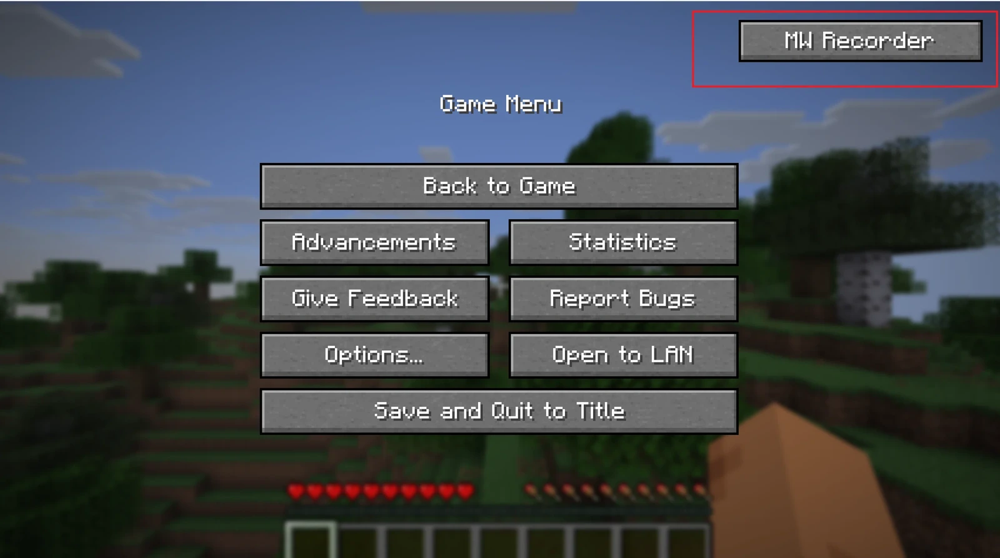
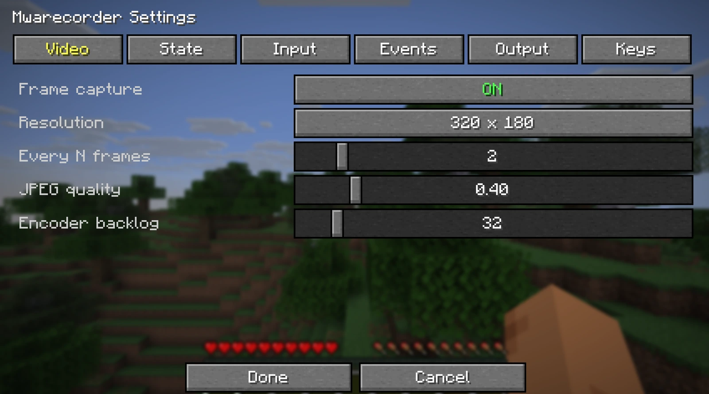
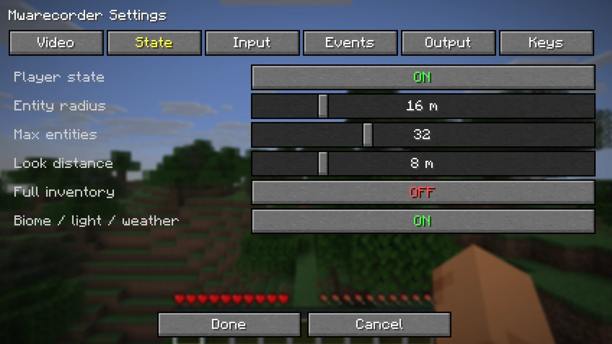
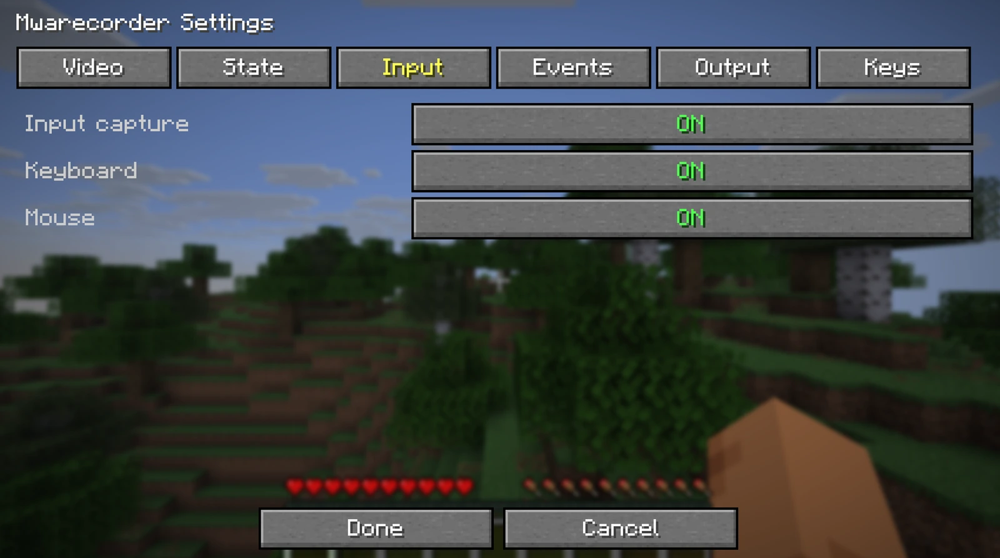
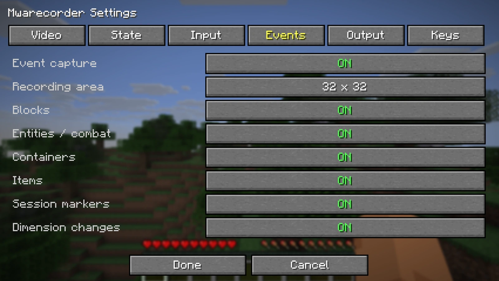
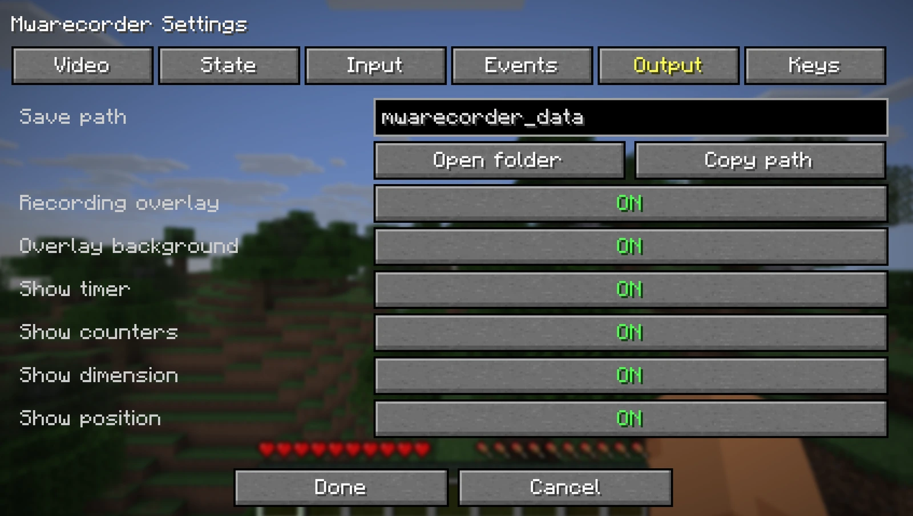
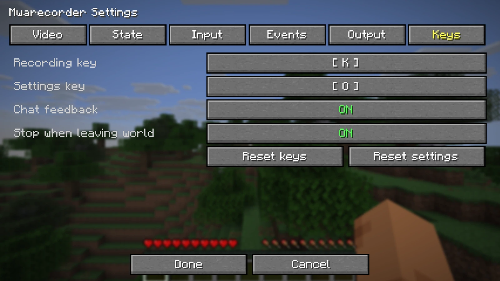

# Mwarecorder

[](https://github.com/Kurisa-kuku/MineWorld-Agent-Recorder/actions/workflows/build.yml)

A Fabric mod for **Minecraft 1.21.7** that records gameplay into a frame-aligned dataset for
world-model research and imitation learning.

<p align="center">
  <a href="https://github.com/Kurisa-kuku/MineWorld-Agent-Recorder/releases">Download</a> ·
  <a href="MWARECORDER_USAGE_EN.txt">User guide (EN)</a> ·
  <a href="MWARECORDER_USAGE.txt">用户说明 (中文)</a> ·
  <a href="https://github.com/Kurisa-kuku/MineWorld-Agent-Recorder/issues">Issues</a>
</p>

While you play, the mod writes four synchronised streams:

| Stream | Content | File |
| --- | --- | --- |
| Video | JPEG frames captured before the HUD is drawn | `frames/` + `frames.jsonl` |
| State | position, rotation, velocity, vitals, held items, looking-at, nearby entities, biome, light, weather | `state.jsonl` |
| Action | movement keys, mouse delta, mouse buttons | `action.jsonl` |
| Events | block break/place/interact, attack/interact, hurt/death/respawn, item use/pickup, crafting/smelting, container open/close, dimension change, session markers | `event.jsonl` |

Everything is aligned on a single `sample_tick` counter, so frame *t*, state *t*, action *t* and
the events of tick *t* form one training sample.

## Requirements

* Minecraft **1.21.7**
* Fabric Loader **>= 0.19.5**
* [Fabric API](https://modrinth.com/mod/fabric-api) for 1.21.7
* Java 21 or newer

## Install

1. Drop `mwarecorder-<version>.jar` and Fabric API into `.minecraft/mods/`.
2. Launch the game with a Fabric profile.

The latest jar is attached to the [releases page](https://github.com/Kurisa-kuku/MineWorld-Agent-Recorder/releases),
or you can build it yourself (see below).

## Quick start

* `K` — start / stop recording
* `O` — open the recorder settings
* `ESC` — the pause menu has an **MW Recorder** button in the top-right corner
* Output defaults to `<game_dir>/mwarecorder_data/episode_YYYYMMDD_HHMMSS/`
* The in-game overlay shows REC/PAUSED, duration, counters and the current dimension

Dimension changes are tracked explicitly: entering the Nether or the End writes a
`dimension_change` event with both positions and the coordinate scale (8:1 for the Nether),
tags every state and frame with its dimension, and keeps the episode alive across the loading
screen.

## In-game UI

### Opening the settings

The settings screen can be opened at any time with `O`, or from the pause menu: the
**MW Recorder** button is in the top-right corner.



### Video

Frame capture on/off, output resolution, how many rendered frames to skip between captures,
JPEG quality and the encoder backlog limit. These values apply to the next episode.



### State

Player observation on/off, the nearby-entity scan radius and cap, the look-at ray length, an
optional full inventory dump, and optional biome / light / weather data.



### Input

Keyboard and mouse action capture.



### Events

Event capture on/off, the recording area (16×16, 32×32, … blocks centred on the player), and
per-category switches for blocks, entities/combat, containers, items, session markers and
dimension changes.



### Output

Save path (absolute, relative to the game directory, or `~`), open-folder and copy-path
shortcuts, and which lines the recording overlay shows.



### Keys

Rebind the recording key and the settings key, toggle chat feedback and auto-stop when leaving
the world, or reset keys / all settings. `Done` saves, `Cancel` (or ESC) discards changes.



## Build

```bat
gradlew.bat build
```

The remapped jar ends up in `build/libs/`. A JDK 21+ must be available on `JAVA_HOME` or
`PATH`; `gradle.properties` deliberately does not hard-code a JDK path.

## Tools

```bat
:: episode -> numpy dataset
python src\main\java\com\kurisa\mwarecorder\tools\episode_to_dataset.py run\mwarecorder_data

:: verify an episode (structure, alignment, dimensions, frame files, ...)
python src\main\java\com\kurisa\mwarecorder\tools\verify_episode.py run\mwarecorder_data --strict
```

Both scripts need Python 3.10+ and numpy.

## Documentation

* [MWARECORDER_USAGE_EN.txt](MWARECORDER_USAGE_EN.txt) — complete English guide: settings
  walkthrough, every configuration key, output schema, event catalogue, dimension handling,
  dataset columns, troubleshooting and code map.
* [MWARECORDER_USAGE.txt](MWARECORDER_USAGE.txt) — the same guide in Chinese (中文).

## Repository contents

This repository contains **source code only**. Recorded episodes — `run/`, `mwarecorder_data/`,
`*.jsonl`, `frames/`, logs and screenshots — are generated locally and are excluded by
`.gitignore`. Do not commit dataset files: they are large and may contain personal gameplay
data.

## License

MIT — see [LICENSE](LICENSE).
